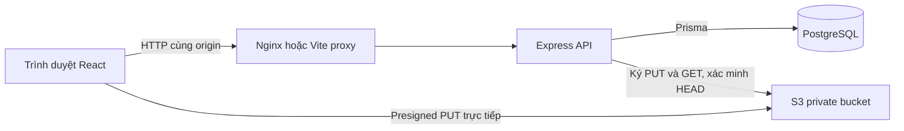

# Kiến trúc CloudTask

## Luồng xử lý

Request đi qua helmet/CORS, JSON size limit, rate limit, Bearer JWT, Zod, controller và service kiểm tra membership trước khi thao tác Prisma. Lỗi trả `{ success: false, message, errors? }`, lỗi nội bộ không trả stack trace hoặc secret. `/health` không yêu cầu đăng nhập và trả 503 khi DB không sẵn sàng, phù hợp ALB readiness.

## Mô hình dữ liệu

- User có nhiều ProjectMember, Task được tạo/được giao, TaskComment và RefreshToken.
- Project có key duy nhất, ProjectMember duy nhất theo cặp user/project và nhiều Task.
- Task có status enum, priority enum, deadline, creator/assignee, comment, attachment.
- RefreshToken lưu hash SHA-256 của opaque token 48 byte; database không lưu token gốc. Refresh dùng transaction và conditional update để một token chỉ xoay được một lần.
- Attachment mở rộng đặc tả bằng objectKey, uploaderId, confirmedAt và uploadExpiresAt. Điều này tránh hiển thị file chưa upload, tránh confirm thay người khác và tránh lưu bucket public URL.

Indexes: project/status cho task; assigneeId; taskId/createdAt cho comment; taskId cho attachment; userId cho refresh token. Prisma include/select tải người tạo, người phụ trách và count trong query theo tập, không truy vấn thêm trong vòng lặp cho mỗi task.

## Session và browser

Access token ở RAM frontend, không localStorage; Axios gắn Authorization và thực hiện một refresh dùng chung khi các request cùng bị 401. Cookie HTTP-only, SameSite Lax, path giới hạn `/api/v1/auth`; production có Secure. Refresh/logout yêu cầu Origin đúng `CORS_ORIGIN` để hạn chế CSRF. Website và API cần chung domain hoặc proxy để cookie cùng site hoạt động.

UI không render HTML từ nội dung task/comment, React escape text; tránh stored XSS. Nginx CSP chỉ cho code nội bộ và kết nối S3. Secret AWS chỉ ở backend/IAM role. Password bcrypt cost 12, giới hạn 72 byte để tránh silent truncation.

## Quyết định thực hiện

Ứng dụng dùng UUID nguyên mẫu; không tạo số task tuần tự vì tài liệu chưa yêu cầu. HTML5 drag/drop phục vụ desktop; mobile/keyboard dùng dropdown trạng thái. Date-only frontend chuyển thành 23:59 tại timezone của người dùng và lưu ISO/UTC. Nội dung dùng plain text, chưa bật Markdown.

Frontend dùng TanStack Query cache và invalidation sau mutation; task status được xác nhận bởi máy chủ rồi refresh thay vì cập nhật lạc quan chưa có rollback. Error state, empty state, loading state, dialog focus trap và keyboard Escape được triển khai. File upload dùng progress event, confirm thành công mới hiển thị.

## Ranh giới triển khai

Đây là ứng dụng đầy đủ theo phạm vi đồ án, có chuẩn bị vận hành cloud. Khả năng phục vụ production phụ thuộc thêm HTTPS, IAM, backup/restore, giám sát, dung lượng và kiểm thử tải trên môi trường thật. Không gọi việc có Dockerfile là bằng chứng đã triển khai AWS thành công.
